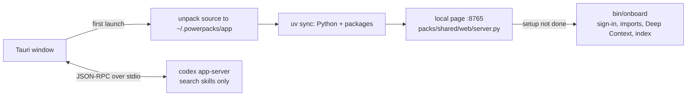

# desktop

The Powerpacks desktop app (Tauri 2). One installer: open it, sign in. The app carries everything
it runs: uv, Codex, and a snapshot of this repo. It is built for macOS only.

Changelog: 2026-10-15 — Install signed updates in the app and restart to run them.



| Path | Role | Reads / writes |
| --- | --- | --- |
| `scripts/bundle-runtime.sh` | Fetches the uv and Codex binaries and archives the repo for the bundle | `src-tauri/binaries/`, `src-tauri/resources/` |
| `splash/index.html` | First page while launch steps run | `boot_state`, `boot://state` |
| `src-tauri/src/boot.rs` | Launch: source, `uv sync`, page server, setup, then the page | — |
| `src-tauri/src/source.rs` | Installs or refreshes the bundled code in the app's folder, `~/.powerpacks/app`; a command-line checkout at `~/powerpacks` is never touched, but its data folder (`.powerpacks/`) and `.env` are shared on first launch so nothing is re-imported | `.powerpacks/desktop/source-version` |
| `src-tauri/src/onboard.rs` | Runs `bin/onboard` and resumes it with what the user answered on the install page | `.powerpacks/install/manifest.json` |
| `src-tauri/src/codex.rs` | One `codex app-server`: ChatGPT sign-in, chats, approvals; only the search skills | `codex://notification`, `codex://request` |
| `src-tauri/src/paths.rs` | The app's folder (or `$POWERPACKS_REPO_ROOT` for development), the bundled binaries, and the PATH children get | — |
| `src-tauri/src/lib.rs` | Window, commands, and the link policy | — |

Setup is clicked through on the install page; no agent runs it. The Connect screen
(`web/src/pages/install/Connect.tsx`) takes every sign-in first (`bin/onboard --logins-only` per
source), so setup then runs without waiting on anyone; `DesktopSetup.tsx` shows anything it still
asks. Which sources are signed in has one answer, `accounts.signed_in`
(`GET /accounts/api/signed-in`), read where each sign-in lives: the screen shows it and setup
takes exactly those sources. Chat (`web/src/pages/agent/`) searches people, companies and dossiers.

Sign-ins happen in a browser, and the app comes forward again when each lands. Powerset's opens
in the default browser: an app's own web view gets none of the Mac's passkeys (macOS keeps them to
the browsers). LinkedIn's opens in the managed Chrome setup uses to read the connections. Google
refuses embedded web views, so Gmail consent opens in the browser through msgvault's own flow,
using Powerpacks' Google OAuth client (`POWERPACKS_GOOGLE_CLIENT_ID` /
`POWERPACKS_GOOGLE_CLIENT_SECRET` in `.env`). ChatGPT (Codex) uses its device-code flow: the app
shows a short code and opens `auth.openai.com/codex/device` in the browser; Codex polls for the
approval and the app comes forward when `account/login/completed` arrives.

## Search questions POC

The existing native Searches view (`/agent`) keeps `@member` questions in the search's
history. Select the audience set, mention a member, and their assistant's answer appears
under the question. **Reply in thread** keeps follow-ups attached to that root question.
Only the question, search title/brief, and thread replies are shared; the private Codex
transcript stays local. Received searches appear in the existing search sidebar.

The recipient explicitly chooses **Answer with my Codex**. A dedicated Codex thread reads
cached local evidence with writes/network access disabled. Delivery retries reuse saved
answers. The older shortlist **Ask the Set** worker is unchanged. Live inference is untested.

Build the web assets and commit them before bundling: the runtime archive uses `git archive
HEAD`. Build with `scripts/bundle-runtime.sh` then `POWERPACKS_DEBUG_MENU=1 pnpm tauri build --bundles app` in
`desktop/`. The installed app refreshes its code from that archive by commit ID; copying
web assets into the runtime folder alone is not an app release. Existing `.powerpacks/`,
`.env`, and `.venv/` are retained during that refresh.

## Build

Needs Rust, Node 22 and pnpm. CI (`.github/workflows/desktop.yml`) builds the Apple Silicon `.dmg` at
release only: a macOS minute costs ten Linux ones. By hand (Actions → desktop → Run workflow, the
branch as `ref`): "release" off gives a test build with the debug menu, "intel" on adds the Intel
app, `Powerpacks-macos-x64.dmg`; both come from that run's artifacts and use the same local data
as the installed app. Each release
(`release-please.yml`) builds the `.dmg` without the debug menu and attaches it to the release as
`Powerpacks-macos-arm64.dmg`, the README's download link; the app's version (tauri.conf.json,
Cargo.toml, package.json) moves with the release, which is what its update check compares. Gmail needs
Powerpacks' Google OAuth client baked in: CI reads `POWERPACKS_GOOGLE_CLIENT_ID` and
`POWERPACKS_GOOGLE_CLIENT_SECRET` from its secrets.

```bash
cd desktop
pnpm install
scripts/bundle-runtime.sh          # uv, Codex, and this repo at HEAD
POWERPACKS_DEBUG_MENU=1 pnpm tauri build --bundles app,dmg
```

The app is ad-hoc signed, not notarized. On first open macOS stops it: open System Settings →
Privacy & Security and click Open Anyway. Notarizing needs an Apple Developer ID.

## Signing

An unsigned or ad hoc signed app is blocked by Gatekeeper on first open ("Apple could not
verify…"). Builds are signed ad hoc (`tauri.conf.json` `signingIdentity: "-"`) until these
repository secrets exist; with them, CI signs with the Developer ID certificate and notarizes
the app, and it opens like any other download. All come from an Apple Developer Program account.

| Secret | What it is |
| --- | --- |
| `APPLE_CERTIFICATE` | The "Developer ID Application" certificate exported from Keychain Access as a `.p12`, base64-encoded (`base64 -i cert.p12 \| pbcopy`) |
| `APPLE_CERTIFICATE_PASSWORD` | The password given when exporting the `.p12` |
| `APPLE_SIGNING_IDENTITY` | The certificate's name, e.g. `Developer ID Application: Powerset Inc (TEAMID1234)` |
| `APPLE_API_ISSUER` | App Store Connect → Users and Access → Integrations → App Store Connect API: the Issuer ID |
| `APPLE_API_KEY` | That API key's Key ID (a key with the Developer role) |
| `APPLE_API_KEY_CONTENT` | The contents of the downloaded `AuthKey_<KEY>.p8` |

**Updater.** Updates use a separate minisign key pair. Keep the private key at
`~/.tauri/powerpacks-updater.key` and its contents in the repository secret
`TAURI_SIGNING_PRIVATE_KEY`; the public key is in `tauri.conf.json` under
`plugins.updater.pubkey`. With `bundle.createUpdaterArtifacts` enabled, local builds need:

```bash
export TAURI_SIGNING_PRIVATE_KEY="$(cat ~/.tauri/powerpacks-updater.key)"
```

CI publishes the signed `.app.tar.gz` and `latest.json` beside the dmg. The app checks that
feed, downloads and verifies the update, installs it in place, then offers a restart.
For a local test feed, bake alternate `plugins.updater.endpoints` into the app with
`pnpm tauri build --config '<JSON config override>'`. An `http://` endpoint also needs
`"dangerousInsecureTransportProtocol": true` beside `endpoints` in `plugins.updater`.
