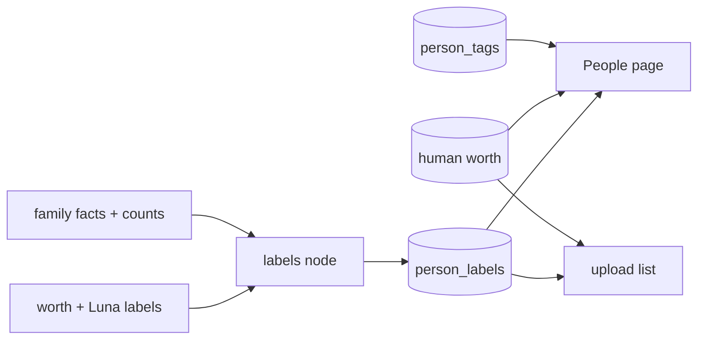

# People labels and upload

Worth asks Luna once per family for worth and labels. The free `labels` node exports
those saved labels to `person_labels`. Human worth and tags stay in their own tables.

| File | Role | Reads | Writes |
|---|---|---|---|
| `questions.py` | Luna label questions | — | — |
| `models.py` | Typed family evidence, labels and tags | — | — |
| `evidence.py` | Join family facts, worth and message counts | v2 store, profile cache | — |
| `labels.py` | Label helpers and family/partner/minor flags | saved labels | — |
| `person_labels.py` | Free `labels` node | family evidence | `person_labels`, `deep-context/v2-manifests/labels.json` |
| `store.py` | Human tags and the upload list | `person_tags`, `person_labels`, effective worth | — |
| `web/model.py` | People rows and details | v2 store, realized rows | — |
| `web/server.py` | People routes | rows | human worth, human tags |
| `web/signals.py` | Refresh worth and label exports | saved evidence, Decisions cache | worth, `person_labels` |
| `web/upload.py` | Upload status and execution | upload list, upload manifest | upload manifest |

The upload list contains effective worth yes, human over machine. The owner is excluded.
Family, partner and minor flags exclude a family unless a human set its worth.

`POST /api/people/worth` takes `{ids: [parent_id], worth: "yes" | "no"}` and records
human worth for every member. `POST /api/people/tags` keeps the human's boolean labels.
Both return updated People rows. The upload feature flag hides the button on the page;
the upload routes remain available.
