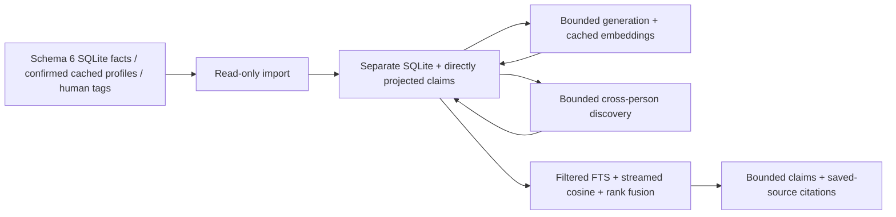

# Isolated memory

Agent retrieval contract: [memory skill](skills/memory/SKILL.md). It owns semantic
routing, evidence expansion and answer citations; the CLI below owns execution.

This package reads original contact names, the current schema 6 Deep Context SQLite (facts, human tags and
`person_labels`: relationship kind, label probabilities and warmth) and saved profiles. A profile contributes only
where someone is, worked and studied; its headline, summary and skills are never projected, generated from or
embedded. Generation reads message dossiers (`facts:` sources) only. Import is read-only. Explicit confirmed selection actions reuse the native
People hide and human-tag writers; inferred-label removal uses memory corrections. Model claims cite saved artifacts; original message citations
are **unverified**. No crawler, message synthesis, identity matching or upload
runs here.



| File | Role | Reads | Writes |
| --- | --- | --- | --- |
| models.py | Typed boundaries and claims | JSON values | Nothing |
| sources.py | Read-only adapters and inventory | Source SQLite and existing profile reader | Nothing |
| store.py | Revisions, vocabulary, corrections, identity projection | Imported artifacts | Derived SQLite only |
| projection.py | Conservative typed projection and family collapse | Saved synthesis, profiles, human tags | Nothing |
| provider.py | No-tracing generation/embedding requests | One bounded input | Provider request with generation `store:false` |
| discovery.py | Original-evidence groups, cached retrieval, bounded interpretations | Original names/projections and existing vectors | SQLite checkpoints and inferred tags |
| discovery_provider.py | Typed discovery decisions and request schema | One representative batch | Nothing |
| generate.py | Up to 64 concurrent generation calls, serial checkpoints and embedding reuse | Derived sources and caches | Derived chunks, claims, vectors |
| query.py | `people`: the one search (owner labels as layers, people ranked with evidence, warmth); hard filters, hybrid claim ranking, tenure overlap | Active claims, streamed cached vectors, labels sources | Query embedding cache |
| directory.py | Typed meanings and complete canonical pages | Current names, tags, claims and cached hybrid query | Query embedding cache only after approval |
| actions.py | Exact native People/tag actions and memory corrections | Explicit corpus-bound enumerated IDs | Existing source owners and memory corrections |
| __main__.py | JSON CLI | Explicit paths and arguments | Derived SQLite; explicit source actions only |

Run from the checkout with its Python environment. The derived DB must be
outside the source roots. Each derived DB accepts exactly one corpus; unrelated
source roots require separate databases. The search skill routes local label and association requests through
`packs/memory/skills/memory/memory-directory.md`. Installed skill copies require
the repository-supported installer before they reflect this checkout.

```sh
python -m packs.memory --db /tmp/memory.sqlite inventory --v2-root /path/to/.powerpacks
python -m packs.memory --db /tmp/memory.sqlite import --v2-root /path/to/.powerpacks
python -m packs.memory --db /tmp/memory.sqlite lookup 'Jordan Bravo'
python -m packs.memory --db /tmp/memory.sqlite generate --model APPROVED_MODEL \
  --embedding-model APPROVED_EMBEDDING_MODEL --limit 1 --dry-run
```

Generation without `--dry-run`, and a nonempty query with an uncached query
embedding, spend provider credits. Obtain a separate estimate and approval
first. Fresh requests require `--approve-spend`; otherwise the CLI emits
`needs_approval` and exits 20 through the shared spend contract. Cached work stays
free. `--limit` bounds total fresh generation and embedding batch requests,
including missing embeddings on resume. Supply `OPENAI_API_KEY` through the environment; no environment file is
loaded. The dry-run requires no key. It reports actual input tokens, output
token caps, existing embedding cache misses and the upper bound on new claim
embedding calls. Apply approved current token prices before requesting spend.

After approval, repeat the generation command without `--dry-run` and with
`--approve-spend`. Repeat the
same command to resume; completed chunks and vectors are reused. One process,
up to 64 in-flight generation requests, replenished as each finishes, at most 9,000 artifact characters and
24 claims per chunk. The shared OpenAI concurrency setting can lower this bound. SQLite writes remain serial. Embeddings use batches of at most 64 documents and
8,000 tokens, with up to eight requests in flight. Both stages lower concurrency
for the configured provider limit, CPU capacity, and available memory (including
Linux container limits), reserving 128 MiB for the app and budgeting 16 MiB per request.
In-flight requests reserve their maximum cost against the shared spend limit.
Every paid generation response is committed before parsing, including malformed,
incomplete and unsupported output. Exclusions are counted and saved on chunks;
unsupported claims never enter search, and rerunning never buys the same response.
Later chunks can progress. Each completed embedding batch is committed before progress is emitted. Imports commit
every 250 identities / 100 sources and reconcile absence only after complete enumeration.
Failed reads preserve prior evidence.

```sh
python -m packs.memory --db /tmp/memory.sqlite search 'my roblox coworkers' \
  --embedding-model APPROVED_EMBEDDING_MODEL --approve-spend
python -m packs.memory --db /tmp/memory.sqlite search 'who is family'
python -m packs.memory --db /tmp/memory.sqlite query 'permission architecture' \
  --embedding-model APPROVED_EMBEDDING_MODEL --approve-spend --kind work --person 'Jordan Bravo'
python -m packs.memory --db /tmp/memory.sqlite query --embedding-model APPROVED_EMBEDDING_MODEL \
  --kind lp --object 'Cedar Fund I'
python -m packs.memory --db /tmp/memory.sqlite overlap 'Jordan Bravo' --organization Acme
python -m packs.memory --db /tmp/memory.sqlite open 1
python -m packs.memory --db /tmp/memory.sqlite correct 1 --reason 'Human retracted unsupported claim'
python -m packs.memory --db /tmp/memory.sqlite confirm-alias IAM 'identity access management'
```

All filters intersect. `--person` must resolve to exactly one canonical parent;
ambiguous names fail closed. Lookup returns every exact normalized identity
match; partial names are not matches. A listed
topic is `mention`; demonstrated work is `work`. LP and preference filters use
the explicit fund/object and scope, never inference from a title. Tenure overlap
requires a start and a known end or explicitly evidenced `present` on both claims.
Unknown dates are excluded. Partial years/months retain their precision and use
calendar interval bounds, so an end of 2020 includes June 2020.
An empty query applies relational filters without an embedding request. Omit
`--embedding-model` for free lexical retrieval. Imported synthesis, profiles and human
tags are searchable immediately, without generation. Topic lists remain mentions;
generic relationship text never becomes LP membership. Family projection reuses
the existing synthesis collapse semantics; identity follows only saved mappings.

Human replacements use `correct ID --replacement /path/to/claim.json --reason ...`.
The JSON contains every `Claim` field (the same shape returned by query).
Retractions/replacements remove current matches, keep prior claims and source
revisions, and survive source refresh and canonical remapping. Replacements
get embeddings on the next generation run. `open` returns the exact stored
source revision, even if the input file has changed or become unreadable.

Exact normalized topics reuse SQLite vocabulary; suggested aliases remain
unconfirmed. Only explicit `confirm-alias` decisions activate aliases.
A conflicting confirmation is rejected before changing the existing confirmed alias. No semantic topic merge is committed;
the separately requested Fable review has not run.

Discovery nominates recurring name tokens/phrases by distinct canonical people,
plus shared original dossier values. Original names cite `candidates` rows even
when synthesis changes the display name. Automatic name seeds exclude stopwords
and tokens shorter than four letters, except original-name acronyms such as SF,
SoF and BA. Targeted `--phrase` inspection remains available. Saved-value seeds
are short structured values (at most 40 characters), not bios or event summaries.
Seeds need the minimum number of exact distinct people before optional neighbors
are added. Normalized claim values are indexed in SQLite; pages do not normalize
the entire corpus again. Case/punctuation normalize, while SF and SoF remain
separate. Name patterns
are evidence to interpret, never identity merge instructions.

```sh
python -m packs.memory --db /tmp/memory.sqlite discover --model APPROVED_MODEL \
  --limit 1 --phrase sof --dry-run
python -m packs.memory --db /tmp/memory.sqlite discover --model APPROVED_MODEL \
  --limit 1 --phrase sof --approve-spend
```

Each request contains at most 16 people and 24,000 characters, owner context,
relevant original vocabulary, and original source excerpts. Saved embeddings
can add approximate semantic neighbors with `--embedding-model`; discovery
also embeds written tags when that model is supplied, reusing cached embeddings.
A temporary SQLite sign index shortlists at most
100 cached candidates by shared bands before cosine ranking. Retrieval is
approximate and has no measured recall guarantee.

Each invocation inspects at most 100 evidence seeds. `next_after` and
`has_more` expose continuation; pass `--after` to continue. If the call budget
ends within a group, the cursor stays before that group and completed response
checkpoints are reused. Preview bounds fresh calls by `--limit` and skips
cached calls when estimating remaining work. Run and cached preview return up
to four interpretations with members, explanations, abstentions and source
support. An unresolved recurring group stays inspectable without becoming a tag.

Model decisions apply only to individually cited people in the supplied batch.
Unsupported people and invalid quotes are excluded; no sample agreement labels
other people. Original human tags remain distinguishable in citation levels.
Inferred labels are naming context only, not nomination or source evidence;
their arrival cannot invalidate their own checkpoints. Discovery's BM25 index
contains only original projections. Confirmed aliases remain human decisions.
Location association does not imply residence, and surnames alone do not imply
family or background. Discovery is model interpretation, not verified recall.

Inventory counts current SQLite candidates, canonical parents, facts, tags and
confirmed profiles, including canonical identities without searchable facts.
Human tags use `person_tags`, and each confirmed profile is imported once under
its stable LinkedIn member identity. Synthetic research profiles are excluded.
Candidates without a canonical parent remain outside memory until Deep Context
resolves identity. Parent and profile references follow `current_parent` and
`current_profile`; memory never merges people. Profile lookups reuse the existing
`profile_keys` reader once per pass, and identifiers reuse the canonical typed reader.
The source opens read-only and requires the current schema; import never migrates it.
The original inputs remain authoritative.

Validation:

```sh
python -m unittest discover -s tests -p 'test_memory*.py' -v
mypy --strict packs/memory
docker run --rm --network none --memory=1g --memory-swap=1g \
  -v "$PWD:/workspace:ro" -w /workspace powerpacks-signals-memory-test:latest \
  python3 -m unittest discover -s tests -p 'test_memory*.py' -v
```

The resource fixture records worker peak RSS and cgroup limits for 10,000
synthetic people from the current SQLite DDL, an interrupted/reopened import,
complete generation, an identical import/run, upstream identity correction and
hybrid querying. Fake vectors
and HTTP mocks establish plumbing, **not semantic recall or live provider logging
privacy**. Live pilot, actual semantic quality and dashboard log absence require
separate approved spend and verification. This package provides no dashboard
verification claim.

Routing verification uses `scripts/verify-memory-routing --live --limit 1`
(first run a pilot; use a fresh `--out-dir` for each run). Cases share the existing
skill-eval JSON format under `evals/memory/`. Unlike the plan-grading runner,
this starts unhinted Codex sessions and checks executed commands and synthetic
SQLite results. It requires subscription auth, blocks provider calls, preserves
transcripts, and flags boundary answers for human review. Omit `--live` for
fixture preparation only; that is not routing proof.
